  

我是 **hhj**，香港中文大学（深圳）CSE 本科生。现在主要在做 HiveLab 合屋，也写 Minecraft 模组，还和同学一起研究过游戏匹配机制。

CSE undergraduate at CUHK-Shenzhen, building a local multi-agent AI workspace.

个人网站：<https://hhj666-bot.github.io/>

## 项目

<!-- HiveLab 上传后，用 <a href="https://github.com/Hhj666-bot/HiveLab"> 包住下面这张图 -->

  

  
  

### 小工具

- **[Dayline](https://github.com/Hhj666-bot/Dayline)**（[在线试用](https://hhj666-bot.github.io/dayline/)）：中英双语日程与周课表，支持冲突提醒，可导出 PDF、PNG 和日历文件，数据只存在浏览器本地。
- **[羽毛球场地预订助手](https://github.com/Hhj666-bot/badminton-helper)**：Tampermonkey 用户脚本，按优先顺序选场并填写表单。

### 技术栈

`TypeScript` `React` `Electron` `Node.js` `SQLite` `Python` `Java` `NeoForge` `Playwright`
